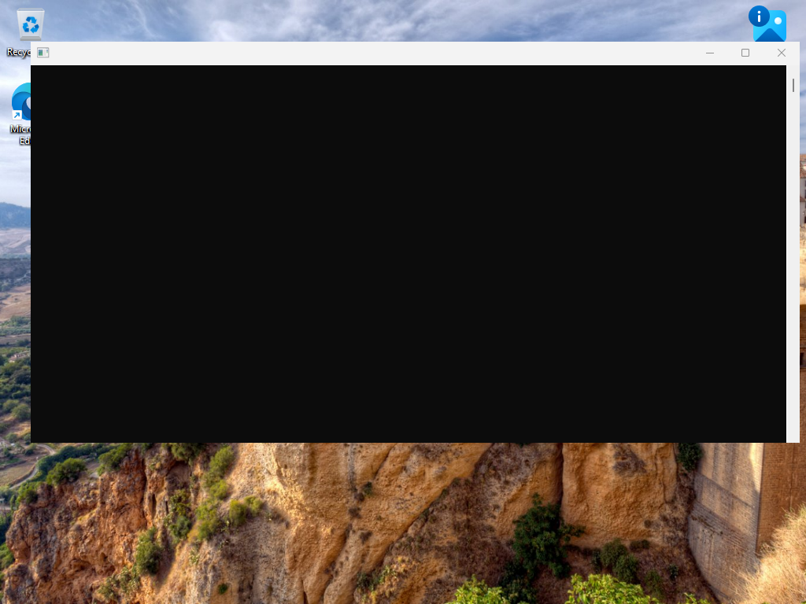

# W32Eleven

**Run 64-bit Windows 11 on a 32-bit PC.**

W32Eleven is an x86-64 PC emulator that runs *on bare metal* on 32-bit x86 CPUs
(i386 + x87 — no SSE, no 64-bit mode needed on the host). It boots straight from
a patched Windows install DVD, emulates a complete x86-64 PC with SeaBIOS, and
translates the guest's 64-bit code to 32-bit host code with its own JIT. Windows
never knows: it sees an ordinary x86-64 PC.



```
 32-bit PC (e.g. Core Duo, Atom N450)
 └─ GRUB (from the patched DVD, or from the disk after install)
    └─ W32Eleven, bare metal, i386 + x87 only
       └─ emulated x86-64 PC: SeaBIOS, VGA, IDE, ACPI, APIC
          └─ Windows 11 (unmodified)
```

## Status

| | |
|---|---|
| **Windows 11** (x64 ISO, build 26300) | Boots through SeaBIOS, `bootmgr` and `winload`; Setup's GUI runs; installs to disk; the installed system boots to the desktop (Start menu, Explorer, DWM composition). [Screenshot](docs/win11-start-menu.png) |
| **Bare-metal boot** (32-bit host) | Patched Windows DVD or USB stick → GRUB → W32Eleven → Windows Setup, tested in QEMU (i386 + KVM). The automatic install runs unattended from the DVD to the desktop (reboots included); the installed disk boots through the emulator without the DVD. |
| **KleinOS** (Multiboot2 ISO) | Boots to the desktop, also on QEMU's software 486 (proves the host code is i386 + x87 only). |
| **Real hardware** | Not tested yet. |

## Performance

Measured in the development harness (`build/hosted32`, a 32-bit Linux process) on one
P-core of an i9-12900KF, booting an installed Windows 11 (first 60 billion guest
instructions, from power-on to the desktop and services):

| | guest MIPS |
|---|---|
| Average over the whole 60G-instruction boot | **~525** |
| Best 5G-instruction stretch | ~1500 |
| Peak (0.5G-instruction window) | ~2100 |
| Interpreter only | ~45 |

Every JIT change is checked for bit-identical guest state against the interpreter
(RAM, framebuffer, registers) at 60 checkpoints. On a real 32-bit CPU expect roughly
5–10× less: Windows works, but slowly — installing takes many hours.

## Quick start

### Build

Requires GCC with 32-bit support (lib32 glibc for the 32-bit harness), GNU ld, NASM,
Python 3; for the ISO tool GRUB (`grub-mkstandalone`, i386-pc) and `xorriso`;
`qemu-system-i386` for tests (KVM recommended).

```sh
make            # build/emulator.elf (bare metal), build/hosted, build/hosted32
make test       # bare-metal self-tests on a QEMU 486
make jit-check  # interpreter vs JIT: identical guest state
```

### Make a bootable Windows DVD for a 32-bit PC

```sh
python3 tools/w32-patch-iso.py Win11_x64.iso Win11_w32eleven.iso
```

This leaves everything in the ISO byte for byte — both file systems and the UEFI
boot entry (UEFI PCs still boot Windows natively) — and appends the emulator,
SeaBIOS, the VGA BIOS, small answer-file CDs and a GRUB boot image, which the BIOS
boot entry now points to. `--in-place` patches an image directly, `--restore` undoes
the patch.

The disc's boot menu:

| Entry | What it does |
|---|---|
| Windows on W32Eleven – with this PC's hard disk | Windows Setup (GUI) with the PC's hard disk attached. |
| Windows on W32Eleven – CD only | Same, without disk access. |
| **AUTOMATIC install – ERASES the first hard disk** | Installs Windows 11 Pro without Setup's GUI (WinPE `diskpart` + `dism` + `bcdboot`), with a local account and auto-logon, and slimmed down for slow PCs (no Defender, indexing, telemetry, animations; `--no-slim` keeps the defaults). Does not ask. |
| Install the W32Eleven boot loader on the hard disk | After installing: puts GRUB and the emulator into the first MiB of the disk, so the PC starts Windows through W32Eleven without the DVD. |

Setup's TPM, Secure Boot, RAM, CPU and storage checks are bypassed with the documented
`LabConfig` registry keys from an `autounattend.xml` on a small virtual CD.

### Try it in QEMU (as a 32-bit PC)

```sh
truncate -s 64G disk.img
qemu-system-i386 -enable-kvm -cpu host -m 3G \
  -cdrom Win11_w32eleven.iso -drive file=disk.img,format=raw,if=ide,index=0
```

### Real hardware

Needed: a BIOS PC (or UEFI with CSM / legacy boot) with an x86 CPU (i386 or later with x87)
and as much RAM as possible (Windows gets up to ~3.5 GB).

- **Boot from DVD or USB stick.** The patched ISO is hybrid: burn it, or write it to a stick
  with `dd if=OUT.iso of=/dev/sdX bs=4M`.
- **Disks:** the emulator reads the boot medium and the hard disk with its own polled
  drivers (IDE/legacy SATA, AHCI) or, for anything else the BIOS can boot from (USB sticks,
  NVMe with CSM, …), through the PC's BIOS (INT 13h from a real-mode thunk).
- **Display:** the VESA mode GRUB sets up; **input:** PS/2 (USB keyboards and mice through
  the BIOS's legacy emulation).
- **CPUs:** the emulated PC has two CPUs (`cpus=1|2` on the emulator's command line), both
  time-sliced on one host core; Windows Setup requires two.

The emulated PC never sees the patch (reads of the boot catalog and of the disk's boot loader
area return the original contents).

## License

W32Eleven is free software: you can redistribute it and/or modify it under the terms of the
GNU General Public License as published by the Free Software Foundation, either version 3 of
the License, or (at your option) any later version. See [LICENSE](LICENSE).

## Legal

W32Eleven is an emulator; it contains no Microsoft code. **Do not redistribute patched
Windows ISOs** — Windows is Microsoft's copyrighted software. Distribute the tool and
let users patch the ISO they downloaded from Microsoft, as Rufus or Ventoy do. Windows
still needs a valid license.

The patched disc embeds third-party free software: GRUB (GPLv3), SeaBIOS and the
VGA BIOS (LGPLv3). Releases that ship these binaries must include or offer their
source code and license notices.

## How it works

- **Interpreter** (`src/emu/cpu.c`, `sse.c`, `x87.c`): real, protected, compatibility
  and long mode; legacy, PAE and 4-level paging with a software TLB; lazy flags;
  x87, MMX, SSE…SSE4.2. SSE floating point is bit-exact with hardware in the fuzzer.
- **JIT** (`src/emu/jit64.c`): x86-64 → i386. Superblocks across conditional branches,
  inline TLB lookups, a stack-region check per block (RSP-based accesses skip the TLB),
  lazy flags with dead-flag elimination and Jcc fusion, block chaining guarded by the
  execution TLB, per-site indirect dispatch, hot and cold code in separate arenas.
  Anything it does not translate runs in the interpreter, one instruction at a time.
  Execution is step-for-step identical to the interpreter.
- **PC** (`src/emu/devices.c`, `chipset.c`, `ide.c`, `apic.c`, `acpi.c`): i440FX/PIIX
  chipset, PIC, PIT, CMOS RTC, UART, PS/2, IDE with ATAPI and bus-master DMA, local APIC
  and IOAPIC, ACPI tables (generated, with a small AML encoder), Bochs VBE display,
  fw_cfg for SeaBIOS.
- **Bare-metal host** (`src/host/`): Multiboot kernel; PIO ATA/ATAPI and AHCI drivers,
  BIOS INT 13h disk access through a real-mode thunk (USB sticks and other BIOS disks),
  VBE display, PS/2 keyboard and mouse passthrough.
- Virtual time is driven by the instruction count, so runs are deterministic.

## Development

`build/hosted` and `build/hosted32` run the same emulator as a Linux process:

```sh
build/hosted32 --ram 2048 --bios /usr/share/qemu/bios.bin \
  --vgabios /usr/share/qemu/vgabios-stdvga.bin --hda win11.img --snapshot \
  --insns 60000000000 --hash
```

Options: `--iso`, `--bios/--vgabios/--cdrom/--hda`, `--snapshot` (writes go to a
temporary overlay), `--insns N`, `--hash` and `--hash-every N` (guest state hashes for
comparing runs), `--shot`, `--text`, `--no-jit`, `--ctl FIFO` (drive a running guest:
`press tab enter`, `type hello`, `mouse 10 -5 1`, `shot out.png`, `stop`, …),
`--events`, `--break`, `--peek`, `--trace-bios`, `--dump-ram`.

Tests:

```sh
make jit-check       # interpreter vs JIT on the KleinOS boot
make cpufuzz         # random instructions: host CPU vs emulator
make boot-test       # KleinOS ISO on the bare-metal image (KVM)
make boot-test-486   # same on QEMU's software 486
```

For Windows, every JIT change is verified by comparing `--hash-every 1000000000` over
60G instructions against an interpreter-only run (`--no-jit`).

Profiling (hosted32): `W32_JITPROF=1` (fallbacks, exits, executed instruction mix —
bit-exact, slower), `W32_HOSTPROF=<icount>` (host PC sampling → `hostprof.txt`),
`W32_PERF=<icount>` (hardware counters: top-down, I-cache, branches),
`W32_TICK=<n>` (timestamp every n instructions), `W32_JITDUMP=<rip>` (guest code of a
block), `W32_JITOFF` / `W32_JITOFF2` (switch translator features off).

## Roadmap

- Faster: the generated code is front-end bound (instruction-cache misses); the next
  step is a block-level code generator with register allocation.
- Testing on real 32-bit machines.
- Guest RAM above 4 GB (PAE host paging).
